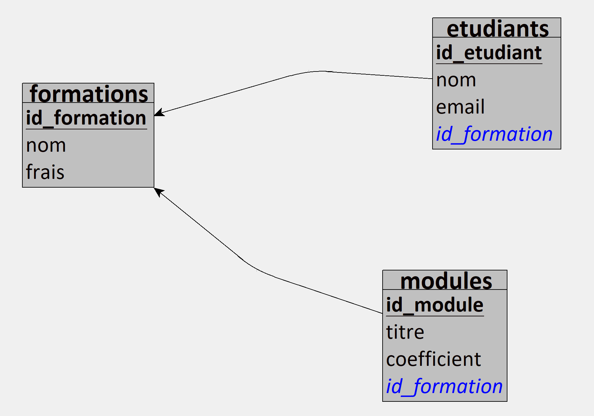
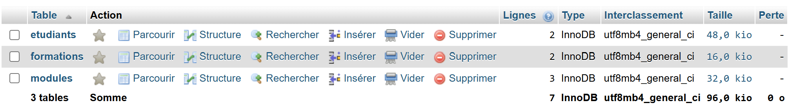

# TP 7 : Conception et CRUD Multi-Entités (PHP, PDO, MySQL)

**Réalisé par :** Yassir Bartani  
**Filière :** Licence Développement Web Full Stack et DevOps  
**Module :** Développement Web Back-End (PHP / MySQL)  
**Année universitaire :** 2026 / 2027  

---

## 1. Contexte et Objectif du Projet

Ce projet consiste à concevoir et développer une application Web dynamique permettant de gérer les activités d'un **centre de formation**. L'application repose sur une architecture PHP procédurale structurée, une connexion sécurisée via **PDO** et une base de données relationnelle **MySQL**.

### Règles métier implémentées :
* Le centre propose plusieurs **formations**.
* Chaque **étudiant** est inscrit dans une seule formation (une formation peut accueillir plusieurs étudiants).
* Chaque **formation** contient plusieurs **modules** (un module appartient à une seule formation).

---

## 2. Phase de Conception (Activités 1 & 2)

### Identification des entités et relations
L'analyse du besoin a permis de dégager trois entités principales :
1. **`formations`** (`id_formation` [PK], `nom`, `frais`)
2. **`etudiants`** (`id_etudiant` [PK], `nom`, `email`, `id_formation` [FK])
3. **`modules`** (`id_module` [PK], `titre`, `coefficient`, `id_formation` [FK])

### Diagramme Entité-Association / Relationnel




> **Interprétation :** Ce diagramme met en évidence deux relations de type **1 à plusieurs (1:N)**. La table `formations` joue le rôle de table parente. Sa clé primaire (`id_formation`) migre en tant que clé étrangère (`FK`) dans les tables enfants `etudiants` et `modules` afin d'assurer l'intégrité référentielle des données.

---

## 3. Création de la Base de Données MySQL (Activité 3)

La base de données **`tp7_crud`** a été créée sous MySQL avec le moteur `InnoDB` pour supporter les contraintes de clés étrangères :
* Sur la table `etudiants`, la contrainte `ON DELETE RESTRICT` empêche la suppression d'une formation tant que des étudiants y sont rattachés.
* Sur la table `modules`, la contrainte `ON DELETE CASCADE` supprime automatiquement les modules associés si une formation est supprimée.

![Structure de la base de données dans phpMyAdmin]

> **Interprétation :** La capture ci-dessus confirme la création effective des trois tables dans phpMyAdmin ainsi que l'ajout d'un jeu de données initiales permettant de tester les opérations CRUD.

---

## 4. Architecture du Projet et Connexion PDO (Activités 4 & 5)

Le projet suit une séparation modulaire avec un dossier dédié à la connexion centralisée (`database/connexion.php`) et un dossier par entité contenant les quatre opérations CRUD (`index.php`, `create.php`, `edit.php`, `delete.php`) :

```text
tp7-crud/
├── index.php                  # Page d'accueil principale
├── README.md                  # Documentation du projet
├── assets/css/                # Feuilles de style (style.css, pages.css)
├── database/connexion.php     # Connexion PDO centralisée
├── screenshots/               # Captures d'écran de validation
├── formations/                # CRUD Formations (index, create, edit, delete)
├── etudiants/                 # CRUD Étudiants (index, create, edit, delete)
└── modules/                   # CRUD Modules (index, create, edit, delete)


## 5. Exploitation des Relations et Affichage — READ (Activités 6 & 10)

Dans les interfaces de liste des étudiants et des modules, l'affichage brut de la clé étrangère (id_formation) n'étant pas lisible pour l'utilisateur, une requête SQL avec INNER JOIN a été utilisée pour récupérer et afficher directement le nom de la formation correspondante.

Interprétation : Grâce à la jointure entre etudiants et formations, le tableau affiche explicitement l'intitulé de la formation (ex. Développement Web Full-Stack) à la place de son identifiant numérique.

## 6. Démonstration Complète des Opérations CRUD (Activités 7, 8, 9 & 12)


A. Ajout d'un enregistrement (CREATE)
-----> 1. Saisie dans le formulaire (create.php) :

Lors de l'ajout d'un étudiant (ou d'un module), une liste déroulante <select> est alimentée dynamiquement depuis la table formations.

Interprétation : L'utilisateur sélectionne le nom lisible de la formation dans la liste, tandis que le formulaire transmet en arrière-plan l'identifiant id_formation via la méthode POST.

-----> 2. Vérification dans l'interface PHP (index.php) :

Interprétation : Après l'exécution de la requête préparée (INSERT INTO), la redirection automatique vers index.php affiche immédiatement le nouvel étudiant dans le tableau.

-----> 3. Confirmation dans la base MySQL (phpMyAdmin) :

Interprétation : La consultation directe de la table etudiants dans phpMyAdmin confirme que l'enregistrement a bien été persisté dans la base de données avec la bonne clé étrangère.

B. Modification d'un enregistrement (UPDATE)
-----> 1. Formulaire prérempli (edit.php) :

Interprétation : L'identifiant passé dans l'URL (?id=...) permet de charger les données actuelles depuis MySQL. Les champs texte et la liste <select> sont préremplis avec les valeurs existantes de l'enregistrement.

-----> 2. Résultat après mise à jour (Interface PHP & phpMyAdmin) :

Interprétation : L'exécution de la requête UPDATE ... WHERE met à jour uniquement l'enregistrement ciblé, ce qui est vérifié à la fois dans le tableau Web et dans phpMyAdmin.

C. Suppression et Intégrité Référentielle (DELETE)
Interprétation : La suppression via DELETE FROM ... WHERE retire l'élément ciblé de la base de données. Par ailleurs, la tentative de suppression d'une formation contenant encore des étudiants est interceptée par un bloc try/catch (grâce à la contrainte ON DELETE RESTRICT), protégeant ainsi la cohérence des données.